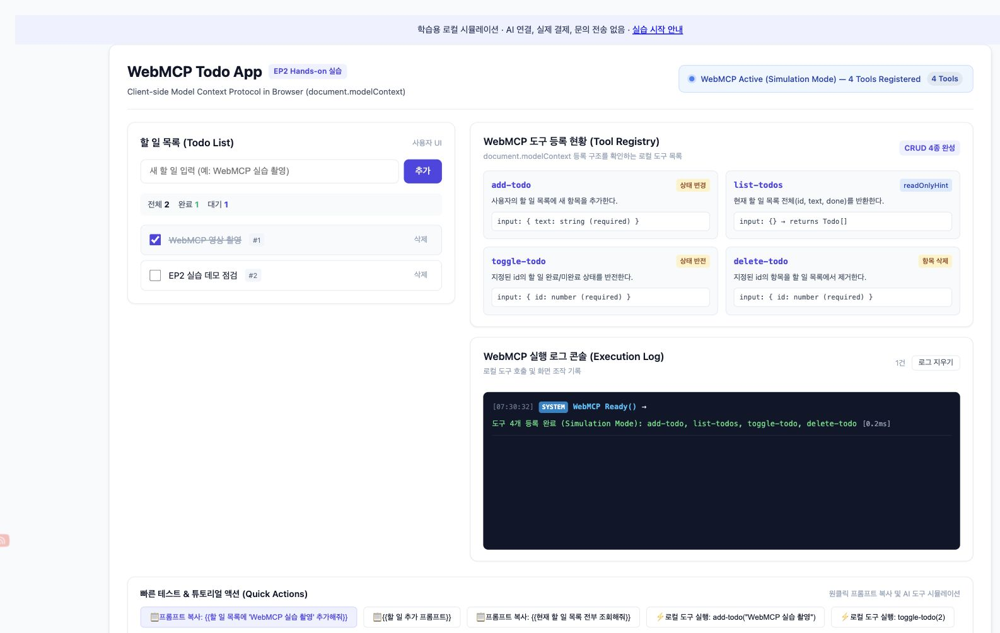
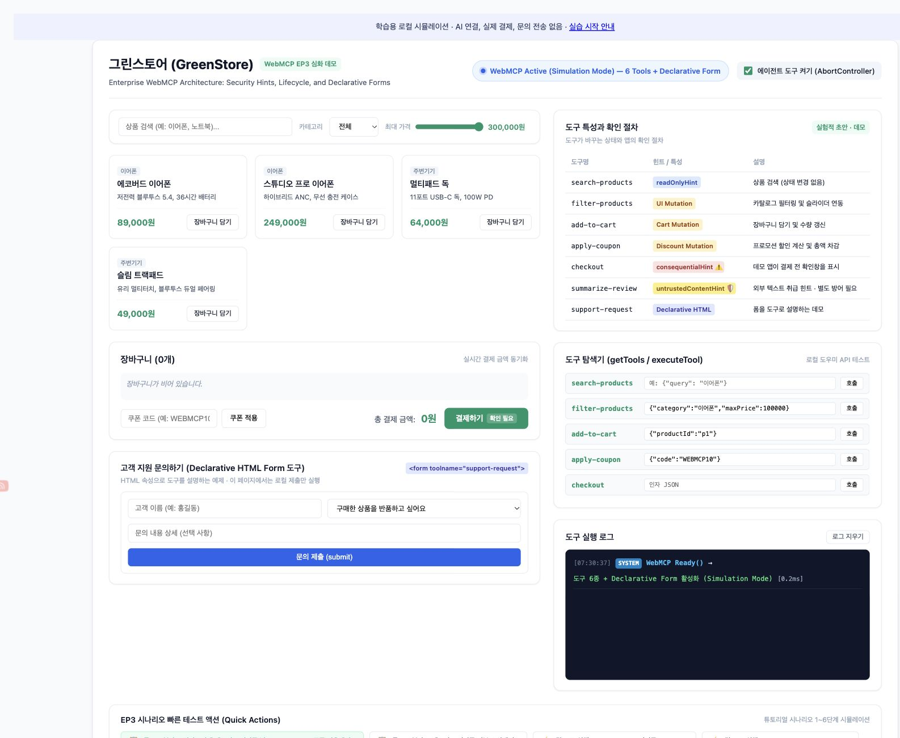

# WebMCP 실습 자료

WebMCP 영상의 **할 일 앱**과 **쇼핑몰**을 직접 조작하며 도구 등록, 상태 변경, 사용자 확인 흐름을 살펴보는 예제입니다.

**[브라우저에서 바로 실습](https://conanssam.com/webmcp-practice/)** · **[단계별 실습 안내](PRACTICE.md)** · **[ZIP 다운로드](https://github.com/jkf87/webmcp-practice/archive/refs/heads/main.zip)**



## 실행 방법

Git과 Python 3가 설치된 터미널에서 실행합니다.

```bash
git clone https://github.com/jkf87/webmcp-practice.git
cd webmcp-practice
python3 -m http.server 4173 --bind 127.0.0.1
```

Windows에서 `python3` 명령이 없다면 `py -m http.server 4173 --bind 127.0.0.1`을 사용합니다.
Git이 없으면 위 ZIP 파일을 내려받아 압축을 풀고, 해당 폴더에서 서버 명령을 실행합니다.
브라우저에서 **http://127.0.0.1:4173/** 을 엽니다. 종료할 때는 터미널에서 `Ctrl+C`를 누릅니다.

## 실습 내용

| 예제 | 확인할 동작 |
| --- | --- |
| [EP2 할 일 앱](demo/ep2-todo.html) | 추가·조회·완료 전환·삭제, UI와 도구 호출 결과 비교 |
| [EP3 쇼핑몰](demo/ep3-shop.html) | 검색·필터·장바구니·쿠폰, 결제 확인창의 취소와 승인, 문의 폼, 도구 해제 |



## 예제가 동작하는 방식

각 HTML 파일에 스타일과 JavaScript가 함께 들어 있습니다. 빌드나 npm 설치, API 키가 필요하지 않습니다. 외부 라이브러리·서버 API·AI 모델을 호출하지 않으며, 새로고침하면 초기 상태로 돌아갑니다.

일반 브라우저에서는 `WebMCPShim`이 등록된 도구를 로컬에서 실행합니다. 화면의 **로컬 도구 실행** 버튼과 **도구 탐색기**는 이 흐름을 직접 확인하는 장치입니다. 프롬프트 복사 버튼은 문장을 클립보드로 복사할 뿐, AI에 전송하지 않습니다.

`document.modelContext`가 감지되면 네이티브 등록을 시도하는 경로도 있으나, 이 저장소는 실제 AI 클라이언트와의 연결을 검증한 통합 예제가 아닙니다. `getTools()`와 `executeTool()`은 이 데모의 도우미 인터페이스입니다. 이를 브라우저 표준 API 사용법으로 그대로 옮기지 마세요.

쇼핑몰의 결제는 확인창과 로컬 상태 변경으로만 동작합니다. 실제 주문·결제·문의 전송은 없습니다. 어노테이션은 도구의 특성을 설명하는 힌트이며, 권한 검사·사용자 확인·프롬프트 인젝션 방어를 자동으로 구현하지 않습니다. 확인창은 이 앱의 코드가 직접 표시합니다.

## 파일 구성

```text
index.html            실습 시작 페이지
PRACTICE.md           단계별 절차와 기대 결과
demo/ep2-todo.html    할 일 앱
demo/ep3-shop.html    쇼핑몰
assets/               실제 실행 화면
```

## 참고 및 범위

코난쌤의 WebMCP 영상 제작용 데모를 공개 실습용으로 정리했습니다. 영상의 자료화면과 주요 동작은 같으며, 공개판에서는 시뮬레이션 안내 문구를 보완했습니다. 이 저장소는 W3C나 Google의 공식 예제가 아닙니다.

- [WebMCP Community Group 초안](https://webmachinelearning.github.io/webmcp/)
- [Chrome WebMCP 문서](https://developer.chrome.com/docs/ai/webmcp)

WebMCP는 실험 단계이므로 실제 서비스에 연결할 때는 위 문서에서 브라우저·클라이언트 지원과 최신 인터페이스를 확인하세요.
별도 오픈소스 라이선스는 지정하지 않았습니다.
